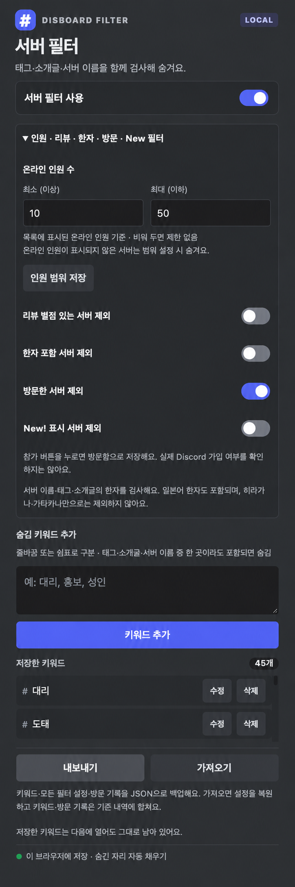

# DISBOARD 서버 필터

DISBOARD에서 원하지 않는 서버를 숨겨 주는 Chrome 확장 프로그램입니다.

## Chrome에 설치하기

1. [최신 버전 다운로드](https://github.com/giinii06/disborad_flilter_chrome_extention/releases/latest)를 엽니다.
2. **Assets**에서 `disborad_flilter_chrome_extention-v1.4.1.zip`을 받습니다.
3. ZIP의 압축을 풀고, 나온 폴더를 보관할 위치로 옮깁니다.
4. Chrome 주소창에 `chrome://extensions`를 입력합니다.
5. 오른쪽 위 **개발자 모드**를 켭니다.
6. **압축해제된 확장 프로그램을 로드합니다**를 누르고, `manifest.json`이 들어 있는 폴더를 선택합니다.
7. Chrome 오른쪽 위 퍼즐 아이콘에서 **DISBOARD 서버 필터**를 찾아 핀으로 고정합니다.
8. [DISBOARD](https://disboard.org/ko/)를 열거나 새로고침하고, 확장 아이콘을 눌러 원하는 필터를 설정합니다.

설치 후에도 압축을 푼 폴더는 옮기거나 삭제하지 마세요. 처음부터 압축을 푼 폴더는 문서 폴더 같은 곳에 넣으면 좋습니다. 

## 적용된 모습

## 필터 설정 화면

숨길 키워드를 입력하고 **키워드 추가**를 누르세요. 온라인 인원 범위와 제외 조건도 설정할 수 있습니다.

## 사용 팁

짧은 시간에 많은 요청을 보내면 DISBOARD에서 일시적으로 접속을 제한할 수 있습니다. 이 경우 잠시 사용을 중단한 뒤 다시 시도해 주세요.

서버의 안정적인 운영을 위해 과도한 요청이나 반복적인 새로고침은 피하는 것을 권장합니다.

 **난 그런 건 모르겠고 빨리 더 쓰고싶은데;;** 싶으신 분들은 

 vpn으로 ip를 변경하면 됩니다.

